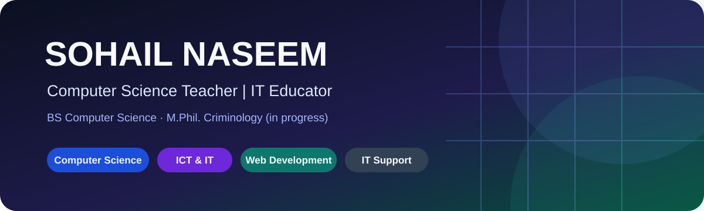
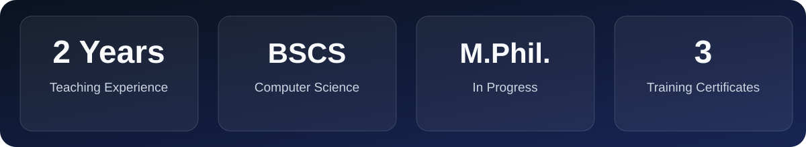
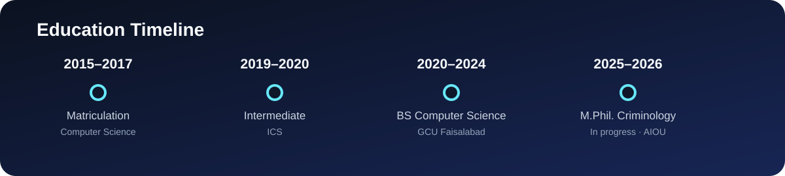

<!-- Professional profile-style README -->

  
  
  <strong>Computer Science Teacher · IT Educator · Computer Science Professional</strong>
   Sahiwal, Punjab, Pakistan
   <a href="https://github.com/sohail566-dev">GitHub Profile</a> · <a href="https://github.com/sohail566-dev?tab=repositories">Repositories</a>

## About Me
I am a Computer Science and IT educator with a **BS in Computer Science** and an **M.Phil. in Criminology in progress**. I bring **two years of teaching experience** in a private-sector college environment, along with experience supporting IT administration, computer labs, troubleshooting, office technology and digital learning.

I focus on making technical concepts accessible through clear instruction, practical exercises and student-focused learning. I am interested in opportunities in Computer Science, ICT, IT education and digital skills training.

## Experience
| Role | Organization | Experience |
|---|---|---|
| Computer Science / IT Teacher | Quaid-e-Azam College, Sahiwal | 2 years |
| IT Administration / Educational IT Support | Private-sector institutions and colleges, Sahiwal | Day-to-day IT operations, user support, troubleshooting and digital documentation |

- Delivered Computer Science and IT instruction through lectures, demonstrations and practical exercises.
- Supported students with assignments, computer-based tasks, projects and examination preparation.
- Assisted with computer lab operations, hardware and software troubleshooting, and user support.
- Used digital tools and office applications to support teaching materials and administrative work.

## Technical Skills
**Computer Science & IT**
   

**Web, Office & Digital Tools**
    

**IT Support & Administration**
   

## Education

| Qualification | Institution | Period / Result |
|---|---|---|
| M.Phil. in Criminology *(in progress)* | Allama Iqbal Open University (AIOU) | 2025–2026 |
| BS Computer Science | Government College University Faisalabad (GCUF) | 2020–2024 · CGPA 3.14/4.00 |
| Intermediate (ICS) | Jinnah College, Sahiwal | 2019–2020 |
| Matriculation — Computer Science | Government High School, Noor Shah | 2015–2017 |

**Certifications & Professional Training**
- Web Development
- Office Management
- Computer Graphics

## Teaching Areas
- Computer Science and Information Technology
- ICT, Digital Literacy and Computer Fundamentals
- MS Office and Office Productivity Tools
- Web Development Fundamentals
- Computer Hardware and Troubleshooting
- Programming and Database Fundamentals
- Computer Graphics and Digital Tools

## Languages
- English — Professional Working Proficiency
- Urdu — Fluent
- Punjabi — Native

## Let's Connect
Interested in Computer Science teaching, ICT education, IT instruction, digital skills training and related education-technology opportunities.

  <a href="https://github.com/sohail566-dev">GitHub Profile</a> ·
  <a href="https://github.com/sohail566-dev?tab=repositories">Explore Repositories</a>
   
  Built around teaching, technology and continuous learning.

